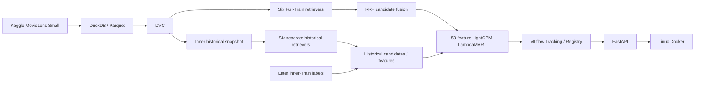

# MovieLens Small — Local Recommendation MLOps

A CPU-first, end-to-end recommendation project: verified data acquisition, deterministic temporal preparation, six retrieval models, candidate fusion, historical LambdaMART training, tracked model releases and portable API serving. The project uses one repository and readable Python modules, with evidence for data lineage, model provenance, inference parity and a controlled final held-out assessment.

**Final Test is complete for the original selected Model Version 1.** The model and selection were frozen before labels were opened. No retraining, Test tuning, model replacement or production promotion followed the result. This is an educational local system with explicit scientific and operational limits.

## Architecture



Full-Train inference and historical ranker training use **separate retriever states**. Later labels are attached only after historical candidates/features exist. See [system architecture and lineage](docs/system_architecture.md).

## Goals and scope

Build one working local lifecycle with reproducible artifacts and defensible offline evaluation. The benchmark uses interaction signals and movie genres, without external embeddings or metadata. Serving loads a selected complete release; it never trains on startup. No cloud infrastructure, frontend, feedback platform or online experiment is included.

## Data and preparation

Source: Kaggle [`grouplens/movielens-latest-small`](https://www.kaggle.com/datasets/grouplens/movielens-latest-small). The frozen acquisition contains **100,836 ratings, 610 users and 9,742 metadata movies**. Only `ratings.csv` and `movies.csv` are modeling inputs. Tags and links are retained as original source material but unused.

Acquisition records provenance, schemas and SHA256 hashes. DuckDB uses explicit types, UTC and bounded in-memory execution, then writes deterministic sorted Parquet. DVC versions the raw acquisition, frozen partitions and diagnostics. The existing EDA is [the Small notebook](notebooks/01_MovieLens_Small_EDA.ipynb); [Phase 1](docs/phase1_data_acquisition_and_eda.md) and [the pipeline report](docs/data_pipeline.md) retain acquisition/recovery evidence.

## Temporal protocol

Primary `small_v1` uses per-user chronological 70/15/15 with whole timestamp ties: **70,186 Train / 15,143 Validation / 15,507 Test**. Policy B uses **7,525 Train-observed movies**, excludes every Train-rated item including lows, and freezes Train histories for both held-out windows. Validation is never appended before Test. Positive feedback means observed rating ≥4 by convention; unobserved pairs are not verified dislikes.

Chronology holds within each user, but other users' Train events can occur after a user's held-out events. **Cross-user future-information exposure is accepted; this is not globally leakage-free prospective evaluation.** Timestamps are rating submissions, not verified viewing. The separate global sensitivity split was prepared but not modeled. [Full evaluation protocol](docs/evaluation_protocol.md).

## Six retrieval channels

| Channel | Retained implementation |
|---|---|
| Popularity | Train-positive counts |
| Genre CBF | Normalized genre vectors and Train-positive user profiles |
| ItemCF | Sparse positive-interaction cosine, bounded top neighbors |
| Implicit ALS | Confidence-weighted user/item factors; documented low/unknown proxies |
| LightGCN | Positive bipartite graph propagation with BPR |
| Hybrid Two-Tower | Learned IDs plus historical/item genres, separate neural towers with BPR |

All six train independently on the full permitted Train context, save/load independently, share eligibility and seen-item rules, and emit deterministic Top-100 streams. Uniform unknown sampling is an implicit-feedback convention. Source scores have different units. [Six-channel measurements and reproducibility](docs/phase3_retrieval_benchmark.md).

## RRF and historical LambdaMART

RRF sums `1 / (60 + source_rank)` over contributing channels in a deduplicated full union. It retains each source's score, rank, membership and fallback flag. LambdaMART ranks that same union using a fixed **53-feature** schema, including RRF, source evidence, historical activity/popularity and genre features. A ranker cannot recover a positive absent from the candidate pool.

Six independent historical retrievers were fitted on **55,807 earlier Train interactions**, then generated candidates/features before **14,379 later Train interactions** supplied labels. Effective training used **528 informative query groups / 57,936 rows**; sampled unknowns have weak zero labels, distinct from observed lows. External Validation NDCG@20 selected **31 trees** from 51 evaluated rounds. Full-Train in-sample predictions were not substituted for historical training features. Feature shifts and sampling limits are recorded in [Phase 4](docs/phase4_fusion_and_ranking.md).

## Measured Validation and one-time final Test

| Method | Validation Recall@20 | Validation NDCG@20 | Test Recall@20 | Test NDCG@20 | Test HitRate@20 |
| --- | --- | --- | --- | --- | --- |
| Implicit ALS | 0.171301 | 0.126085 | 0.115124 | 0.075881 | 0.459691 |
| Six-channel RRF | 0.164938 | 0.127578 | 0.117521 | 0.085011 | 0.468268 |
| LambdaMART v1 | 0.187106 | 0.142799 | 0.128886 | 0.092294 | 0.492281 |

Validation uses **579 users / 6,491 eligible positives**; final Test uses **583 / 6,725**. Every eligible user remains, including zero-hit queries. ALS preserves its source order within the common union; all rows use equal ranked K. Test candidates were generated for all 610 Train users and sealed before label-side population selection.

Test full-union macro recall ceiling is **0.520283**; micro positive coverage is **2,854/6,725 = 42.44%**, with **51 zero-union-hit users**. Those differ from final Top-K scores. The selected ranker's Recall@20 and NDCG@20 decline from Validation. Sparse Test users (n=13) have Recall@20 **0.141026** under LambdaMART versus **0.179487** under RRF; the prior regression persists. Three cold-positive-history Test queries all have zero Top-20 hits.

Paired 2,000-replicate user bootstrap (seed 42) gives LambdaMART-minus-RRF NDCG@20 **+0.007283**, 95% percentile interval **[0.000476, 0.014430]**. This describes uncertainty within the frozen sample after Validation selection; it does not establish online lift, universal improvement or production readiness. The model remains Version 1 regardless of comparator results. [Complete final report](docs/phase7_final_evaluation.md), [aggregate metrics/cohorts/intervals](docs/phase7_final_metrics.json), [verification](docs/phase7_verification.json).

## Technology stack and repository

Python **3.11.9**, uv **0.13.6**, DuckDB **1.5.2**, DVC **3.67.1**, NumPy/pandas/PyArrow/SciPy, implicit **0.7.2**, Torch **2.11.0**, LightGBM **4.6.0**, MLflow **3.17.2**, FastAPI **0.162.0**, Uvicorn **0.54.0**, Docker Linux ARM64. `pyproject.toml` and `uv.lock` are authoritative; train/rank/mlops/serve groups separate dependency purposes.

```text
src/recsys/               # data, six retrievers, contracts, metrics, fusion, ranking, release
src/recsys_serving/       # typed HTTP adapter around complete registered pyfunc
src/recsys_evaluation/    # frozen final-evaluation gates; no model fitting
tools/                   # explicit stage, export, parity and verification entry points
tests/                   # synthetic correctness and integration fixtures
configs/                 # selected model configurations
notebooks/               # Small EDA explanation
docs/                    # protocols, phase evidence and architecture
archive/legacy_movielens32m/  # preserved reference work
data/, artifacts/, outputs/  # generated private local assets, excluded from Git
params.yaml, dvc.yaml, dvc.lock, pyproject.toml, uv.lock
Dockerfile, .dockerignore
```

## Local setup and data recovery

Run from the repository root with uv available. For a **fresh environment**:

```sh
uv venv --python 3.11.9
uv sync --locked --group train --group rank --group mlops --group serve
UV_CACHE_DIR=.uv-cache uv lock --check --offline
```

Source checkout alone has **no raw data, DVC remote objects, trained checkpoints, MLflow SQLite/Registry or model exports**. To recover the existing frozen data you need access to the original local DVC remote (or a verified copy), outside this checkout:

```sh
# Configure the actual existing object store; this does not populate an empty remote.
.venv/bin/dvc remote add --local --default local /absolute/path/to/existing/dvc_remote
DVC_NO_ANALYTICS=1 .venv/bin/dvc pull
.venv/bin/python -B -c "from recsys.small_data import verify_provenance; verify_provenance('data/raw/ml-latest-small'); from recsys.small_pipeline import verify_files; verify_files('data/splits/small_v1'); print('Frozen data hashes verified')"
```

For a first independent Kaggle acquisition, install the declared acquisition extra and run `tools/download_movielens_small.py`; this was **not rerun in Phase 7**. A new provenance timestamp differs from the frozen pin and requires an explicit new version. Acquisition, preparation and validation commands are detailed in [data recovery](docs/data_pipeline.md).

**Do not force-reproduce frozen v1 under the current global training/serving lock.** Its data writer embeds the original whole lock; later dependency additions cause documented DVC drift. Data restoration/hash verification works without rewriting that identity. A separate future data-environment migration is required for a new safe pipeline version.

## Available training workflows

Existing CLI stages are explicit and immutable. Reproducing training requires restored data, the locked training environment and **new run IDs**, then preserving the original selection separately:

```sh
.venv/bin/recsys --help
# Example only: fits a new model; not needed to serve existing Version 1.
.venv/bin/recsys train --model popularity --config configs/popularity.yaml --run-id my_replay
.venv/bin/recsys evaluate --model popularity --split validation \
  --checkpoint artifacts/popularity/my_replay --run-id my_validation
```

[Phase 3 commands](docs/phase3_retrieval_benchmark.md) cover all six models; [Phase 4 commands](docs/phase4_fusion_and_ranking.md#commands-and-verification) cover fusion, separate historical fitting, features and ranker fitting. Later fits do not reproduce the existing Registry automatically. Packaging/registration requires the complete verified artifacts and original lineage, as described in [Phase 5](docs/phase5_mlflow_registry.md).

## MLflow tracking and complete release

The existing owned local server is at **http://127.0.0.1:5002**; inspect its actual state before use:

```sh
scripts/start_mlflow.sh start
scripts/start_mlflow.sh status
.venv/bin/python -B -c "from mlflow import MlflowClient; v=MlflowClient(tracking_uri='http://127.0.0.1:5002',registry_uri='http://127.0.0.1:5002').get_model_version('MovieLensHybridRecommender','1'); print(v.name,v.version,v.run_id,v.tags['release_id'])"
```

This requires the existing local MLflow database/artifacts. Starting an empty server does not restore Version 1. Immutable URI **`models:/MovieLensHybridRecommender/1`** identifies a complete release, including all six weights, Train context/history, feature schema and booster. The unchanged `candidate` alias is not used for fixed-version selection. The original `test_evaluated=false` metadata remains historical; final results live in a **separate** evaluation run:

- Experiment: `MovieLens-Small-Final-Evaluation` (ID 5).
- Final run: **`12f4fed76651402c97c09df96d6360dc`**.
- 631 aggregate metrics in `test/policy_b/*`, `test/all_observed/*`, `test/union/*`, `test/paired/*` and `validation_to_test/*`.
- Original 21 MLflow records and Version-1 tags/aliases remain unchanged; no new model version or promotion.

The local SQLite database and artifact tree must be backed up consistently together. They are not in Git or DVC. [MLflow startup, storage and recovery](docs/mlflow_local_setup.md).

## Export and native FastAPI serving

From a functioning original Registry, export to a **new** destination; never overwrite an existing completed export:

```sh
.venv/bin/python -B tools/export_serving_model.py --tracking-uri http://127.0.0.1:5002 \
  --destination outputs/deployment_models/NEW_movielens_hybrid_v1
RECSYS_MODEL_SOURCE=local \
  RECSYS_MODEL_PATH="$PWD/outputs/deployment_models/NEW_movielens_hybrid_v1" \
  RECSYS_HOST=127.0.0.1 RECSYS_PORT=8000 .venv/bin/python -B -m recsys_serving
```

A separately obtained verified **outer MLflow export** is sufficient for offline serving; raw `artifacts/releases/phase5_v1` lacks `MLmodel` and is not the serving path. Exports contain Train histories and must stay private. The API loads once, checks hashes/version/schema before readiness, enforces bounded batch/body sizes and rejects concurrent inference with 503. No startup retraining or hidden error fallback occurs.

| Endpoint | Purpose |
|---|---|
| `GET /health/live` | Process liveness |
| `GET /health/ready` | Verified model loaded |
| `GET /model-info` | Sanitized release identity and load counter |
| `POST /recommend` | Ordered known-user recommendations or explicit unknown-user popularity |

```sh
curl http://127.0.0.1:8000/health/ready
curl -H 'Content-Type: application/json'   -d '{"user_ids":[1,1000610],"top_k":3}' http://127.0.0.1:8000/recommend
```

Responses include model name/version, user groups and movie_id/rank/score/fallback. IDs must be unique positive integers; K is 1..100 and may yield fewer rows. Scores are not calibrated probabilities.

## Linux Docker deployment

The verified target is `linux/arm64`, with CPU-only inference. Use a free localhost port/new container name and an existing verified export:

```sh
docker build --platform linux/arm64 --progress plain -t movielens-recsys-api:phase6_v1 .
docker run -d --name my_movielens_api --platform linux/arm64 --cpus 2 --memory 3g --pids-limit 256 \
  --read-only --cap-drop ALL --security-opt no-new-privileges \
  --tmpfs /tmp:rw,noexec,nosuid,size=536870912 -p 127.0.0.1:8001:8000 \
  --mount "type=bind,source=$PWD/outputs/deployment_models/NEW_movielens_hybrid_v1,target=/models/movielens_hybrid_v1,readonly"   movielens-recsys-api:phase6_v1
curl http://127.0.0.1:8001/health/ready
docker logs my_movielens_api
docker stop --timeout 30 my_movielens_api
```

The existing Phase 6 container may already occupy 8001. The image runs non-root with one worker, read-only root/model mount and bounded memory/CPU. Phase 6 measured **exact native/Linux parity across 611 inputs / 12,220 rows**, including restart while MLflow was offline. It is **8.54 GB** because the unchanged exact Torch contract pulls CUDA-linked Linux dependencies; inference uses CPU with CUDA unavailable. Optional direct Docker Registry startup fails MLflow host-header checks (403); use the verified offline mode. No image was published. [Full deployment evidence](docs/phase6_fastapi_docker.md).

## Tests and final-evidence verification

```sh
MPLCONFIGDIR=.venv/mplconfig PYTHONDONTWRITEBYTECODE=1 .venv/bin/python -B tools/run_tests.py
UV_CACHE_DIR=.uv-cache .venv/bin/uv lock --check --offline
git diff --check
# Requires this original machine's retained final-evaluation evidence/model assets.
.venv/bin/python -B tools/verify_final_evaluation.py --tracking-uri http://127.0.0.1:5002
```

**104 tests pass, zero failures/skips, in working and isolated locked Mac environments.** These include synthetic mathematical/training fixtures, leakage/eligibility/denominator checks, serialization, MLflow and API tests. Genuine MovieLens fitting occurred in Phases 3/4, not Phase 7. Final verification rechecks saved evidence without generating a new Test prediction/evaluation. Do not rerun the one-shot Test gate to search for a better score.

## Storage, limitations and next improvements

Git holds source/configuration/locks, DVC pointers and aggregate reports. DVC's external local remote holds data objects; ignored `artifacts/` holds checkpoints; ignored `outputs/mlflow/` holds tracking/registry state; exports and detailed per-query evidence remain ignored/local. No public user histories, Test labels or prediction tables were added. Historical [32M material](archive/legacy_movielens32m/README.md) is reference-only.

Data byte reproducibility was verified on this Mac; full model training was replayed in an isolated locked Mac environment. Serving parity was tested on macOS and real Linux ARM64. Those are different claims from arbitrary-platform training reproducibility or final Test quality. No one-command fresh-clone lifecycle has been independently verified.

Small data/cohorts, Validation selection, weak unknown labels, frozen histories, snapshot feature shift and cross-user temporal exposure limit generalization. The bootstrap describes paired sample variation without addressing all these biases. No exposure logs, online CTR, causal satisfaction, public production load validation, authentication layer or automatic remote backup is claimed.

Future work: versioned data-environment isolation; globally chronological sensitivity modeling; more historical snapshots and sparse-user analysis on future data; an explicitly versioned CPU-wheel compatibility contract to reduce image size; deliberate release/promotion and backup policy; online evaluation only with appropriate new evidence. Test outcomes are recorded, not a new tuning set.

This project demonstrates concrete data provenance/versioning, deterministic preprocessing, independent multi-stage models, out-of-time ranking examples, model checkpoint portability, MLflow lineage, complete model registration, inference packaging, API parity and container deployment.

## Dataset acknowledgment

Thanks to GroupLens / the University of Minnesota and MovieLens contributors. Acquisition uses the Kaggle source above. The distributed dataset README carries usage conditions, including attribution, no implied endorsement and conditions on redistribution/commercial use; review that original document before reuse. No broader dataset rights or project software license are asserted here. Cite Harper and Konstan, *The MovieLens Datasets: History and Context* (2015), [DOI: 10.1145/2827872](https://doi.org/10.1145/2827872). This is a development dataset whose contents may change; the repository pins its particular verified acquisition.
