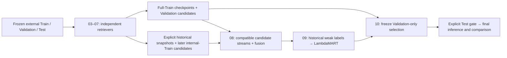

# MovieLens 32M recommendation research

Readable Python modules implement six independent retrieval experiments, candidate fusion, and temporal learning-to-rank. Notebooks configure and explain each experiment; they import code from `src/` and contain no encoded package payloads. The original large Notebook 03 remains unchanged as a **legacy reference**, including its existing outputs. New work uses the notebooks below.

This is an offline research framework, not a deployment service. No full MovieLens training or real benchmark results were produced during this refactor.



## Layout

```text
hybrid_recsys/
├── AGENTS.md
├── README.md
├── requirements.txt
├── archive/                         # original project; untouched
├── configs/                         # common and per-model JSON
├── notebooks/
│   ├── 01_MovieLens32M_EDA.ipynb                 # preserved
│   ├── 02_MovieLens32M_Data_Split.ipynb          # preserved
│   ├── 03_MovieLens32M_Retrieval_and_Ranking.ipynb # legacy; preserved
│   ├── 03_Popularity_Genre.ipynb
│   ├── 04_ItemCF.ipynb
│   ├── 05_Implicit_ALS.ipynb
│   ├── 06_LightGCN.ipynb
│   ├── 07_Two_Tower.ipynb
│   ├── 08_Retrieval_Fusion.ipynb
│   ├── 09_LightGBM_Ranking.ipynb
│   └── 10_Final_Evaluation.ipynb
├── src/recsys/
│   ├── data.py, contracts.py, artifacts.py, features.py
│   ├── config.py, runtime.py, metrics.py, evaluation.py, workflows.py
│   ├── retrievers/                  # all six migrated algorithms
│   ├── fusion/                      # candidates, RRF, diagnostics, workflow
│   ├── rankers/                     # features, Parquet sequence, LambdaMART, workflow
│   ├── final_evaluation.py, smoke.py
│   └── experiment.py, candidate_fusion.py, ranking_features.py
│                                     # legacy orchestration/compatibility APIs
├── tests/
└── tools/
```

The following data/output directories are **runtime locations**, not pre-created datasets or fabricated experiment artifacts:

```text
data/ml-32m/{ratings.csv,movies.csv}
data/splits/v1/{train,validation,test,user_eval_cohorts,item_eligibility}.parquet
data/splits/v1/split_manifest.json
artifacts/<popularity|genre|itemcf|implicit_als|lightgcn|two_tower|lightgbm>/<run_id>/
results/<validation|rank_train|test>/<model>/<run_id>/
results/fusion/<validation|rank_train|test>/<fusion_id>/
results/comparisons/<selection_id>/
```

## Colab setup and first execution

Copy or clone the **readable repository**, including `src/`, `configs/`, `tests/` and `notebooks/`, into:

```python
PROJECT_DIR = Path(
    "/content/drive/MyDrive/Colab Notebooks/"
    "personal_projects/movielens_hybrid_recsys"
)
```

The source must exist at `PROJECT_DIR/src/recsys/`. A notebook cannot import modules merely because unrelated Python files were attached to a chat or are elsewhere on Drive. These notebooks mount Drive and use normal imports from that exact source path. They detect another source copy or changed cached modules and require a runtime restart. They never extract an embedded source archive.

Use a Colab runtime with the packages in `requirements.txt`; PyTorch/CUDA is needed for neural models and the complete synthetic suite. CPU-only runtimes work for the lightweight models and CPU synthetic tests. L4/24 GB GPU and High-RAM are recommended for real neural experiments, but actual RAM/VRAM/disk are checked dynamically. Do not replace Colab's CUDA PyTorch blindly. No notebook installs dependencies automatically. After approval, install missing packages with the normal package manager, for example:

```python
# Run only after approving installation in your Colab runtime:
%pip install -r "/content/drive/MyDrive/Colab Notebooks/personal_projects/movielens_hybrid_recsys/requirements.txt"
```

Open **`03_Popularity_Genre.ipynb`** first. Leave `RUN_MODE="smoke_test"` and run its cells top to bottom. This exercises disposable synthetic data only. Then choose `full_train` to fit/evaluate the two baselines on all external Train; the shared baseline preparation avoids loading Train twice. Copy the printed checkpoint and candidate paths. There is no real dataset download or split regeneration in these notebooks.

## Execution modes and independent notebooks

| Notebook | Real modes | Dependency |
|---|---|---|
| 03 Popularity / Genre | `full_train`, `load_evaluate`, `rank_snapshot` | Frozen dataset only |
| 04 ItemCF | same | Frozen dataset only |
| 05 Implicit ALS | same | Frozen dataset + implicit library |
| 06 LightGCN | same | Frozen dataset + CUDA PyTorch for full training |
| 07 Two-Tower | same | Frozen dataset + CUDA PyTorch for full training |
| 08 Fusion | `load_evaluate` | Six compatible saved candidate artifacts |
| 09 LightGBM | `full_train`, `load_evaluate` | Historical fusion + full-Train Validation fusion |
| 10 Final Evaluation | `load_evaluate` | Explicit saved Validation selection; Test additionally gated |

All eight default to `smoke_test`; unsupported modes fail clearly. Model notebooks 04–07 can be run in any order and in fresh Colab sessions. None depends on another notebook's variables. `full_train` in Notebook 09 means fitting the ranker from historical candidate features, not fitting retrievers. In model notebooks, `load_evaluate` requires an explicit checkpoint path and never calls fit. Candidate and fusion artifacts are reused only after checksum and compatibility checks.

## Frozen data and shared evaluation

The split manifest is authoritative. Expected partition counts are integrity expectations:

- Train: **31,414,033** ratings, all historical interactions before Validation.
- Validation: **300,000** ratings immediately before Test.
- Test: **286,171** ratings in the existing final-three-calendar-month protocol.

No external partition is modified or resplit. Training reads only ratings-derived artifacts and `movies.csv` (movie IDs, titles and genres). No tags, links, Tag Genome, external metadata or pretrained embeddings are used. Development verifies Train/Validation without deserializing Test labels. The original ratings CSV is checksummed as an opaque source file; its future ratings are not parsed into development features. Test labels open only after the final gate.

Observed positive is `rating >= 4.0`. Observed low ratings and missing/unobserved pairs remain separate concepts. **Policy B** uses movies with at least one Train rating. Every Train-rated movie, including a low rating, is removed from that user's candidates. Train-only histories are frozen for both Validation and Test; Validation is never appended.

The fixed primary population contains all users with at least one eligible future positive. It is checked against the frozen Validation cohort table, read only for evaluation eligibility/reporting. Cold / 1–4 / 5–19 / 20+ positive-history cohorts use Train only. Each candidate manifest identifies the exact user/label population, catalog, mapping and boundary; incompatible outputs cannot fuse.

Every channel uses at most Top-100, exact eligible-catalog scoring in chunks, deterministic movie-ID tie breaking and the same filtering. Top-K is an upper bound: fewer eligible movies means fewer candidates. No full user-item prediction matrix is constructed. Metrics are user-macro Recall@20/50/100, HitRate@20/100, NDCG@20, catalog coverage, popularity concentration and user-bootstrap confidence intervals. No-hit queries remain in unconditional evaluation. Coverage is Top-100 for individual retrieval and Top-20 for ranked methods. Pool recall uses the entire union and is not a Top-100 ranking score.

## Migrated models and common interface

All six algorithm implementations were reused from the previous readable package (and checked against the legacy bundle). New orchestration calls one shared factory:

```python
from recsys.training import fit_retriever, load_model
model = fit_retriever(context, "itemcf", config, device="cpu")
rows = model.retrieve(user_id, k=100)
batch = model.retrieve_many(user_ids, k=100)
model.save(checkpoint_directory)
model = load_model(context, "itemcf", checkpoint_directory, device="cpu")
```

The notebook-level `RetrievalExperiment` adds read-only data preparation, versioned checkpoints, manifests and evaluation. The legacy name `als` remains supported internally; all **new** candidate sources and artifact folders use `implicit_als`.

| Channel | Objective / representation |
|---|---|
| Popularity | Train-positive interaction count; explicit cold-history fallback |
| Genre | Normalized genre multi-hot vectors and Train-positive user profiles; empty-profile fallback |
| ItemCF | Binary positive cosine; sparse bounded neighbor index; full positive-history similarity sum |
| Implicit ALS | Positive preference 1 with higher confidence; observed low preference 0 with explicit confidence; missing preference 0/confidence 1 |
| LightGCN | Exact sparse normalized positive-edge propagation, layer average, BPR positive-versus-unknown loss |
| Hybrid Two-Tower | User ID + cutoff genre profile, item ID + genres, MLPs, normalized vectors and sampled-pair BPR |

LightGCN preserves the existing exact graph-polynomial/adjoint implementation: microbatched BPR gradients across every positive edge, **one large-batch Adam step per epoch**. It is not per-minibatch SGD and needs appropriate Validation tuning. Neural unknown draws reject all observed user-item pairs. Unknowns are a training convention, not verified dislikes. Full-Train neural early stopping uses a deterministic Validation-only panel; snapshots use fixed configured epochs/training loss without internal future labels.

## Artifacts, provenance and resume

`artifacts/<model>/<run_id>/checkpoint/` contains model parameters/index/embeddings, mappings, config, training history, resource profile and manifest. Neural epoch snapshots additionally contain weights/optimizer state. `COMPLETE.json` records file sizes and hashes. Writers stage locally, copy to Drive, verify, then publish the completed directory. Existing valid artifacts are never silently replaced; visible incomplete/corrupt artifacts fail explicitly. Hidden interrupted copies are ignored.

Run IDs incorporate source-file hashes, configuration, split checksum, training boundary, canonical mappings/catalog and evaluation population. Model source hashes cover shared protocol code plus that producer, so changing an unrelated model does not invalidate every checkpoint. Changing shared protocol code does. Use the same readable source version and saved configuration to load a checkpoint.

Candidate results are a query-sorted Parquet file with `userId,movieId,score,rank,source` plus `fallback`. The accompanying manifest includes the model/version, source hashes, split version/checksum, cutoff, catalog policy/ID, mappings, evaluation ID, K, seed, hyperparameters and candidate checksum. Within each model artifact directory, a candidate reference and metrics point to its result artifact without duplicating large tables.

To resume, reopen that notebook with the same source/configuration. Completed matching model and result stages are verified/reused. `load_evaluate` provides an explicit checkpoint-only route. Interrupted neural channels restart from the seed; epoch state is preserved but automatic mid-epoch restoration is not implemented. Resource errors preserve completed stages; do not relabel a partial experiment as a full benchmark.

New `modular_v2` artifacts have explicit per-model candidate contracts. Old `recsys_v1` monolithic artifacts are preserved and **not automatically treated as modular inputs**. No legacy data is migrated or overwritten silently. To reuse legacy checkpoints, first implement/review an explicit converter that verifies the new provenance/temporal contract; otherwise rerun the selected model independently.

## Fusion without retraining

Paste the six saved candidate directories into Notebook 08. The manifests must agree on split, training kind/cutoff, label interval, catalog, mappings, evaluation ID and K. Hyperparameters and raw score scales may differ. Union/deduplication streams complete user groups, preserving scores/ranks/presence and fallback flags. Scores are never assumed calibrated. RRF uses `sum(present/(60+rank))`; overlap, unique relevant contributions, pool recall, coverage/popularity and remove-one-channel ablations are reported on identical users.

Fusion writes `features.parquet` in bounded query batches, with an explicit cutoff-only feature allow-list. Future `label` and `feedback_kind` columns are separate from that list. The complete table is never concatenated into one DataFrame. `results/fusion/validation/...` and `results/fusion/rank_train/...` are separate outputs.

## Historical snapshots and independent LambdaMART

Full-Train models are valid for external Validation candidates, **not unbiased in-sample ranker training examples**. When ready for ranking experiments, set the same explicit UTC `SNAPSHOT_CUTOFF_UTC` in each model notebook and choose `rank_snapshot`. The history is at or before that cutoff; labels are strictly after it, still inside original Train, and before the configured exclusive end. These future labels do not affect retriever fitting/stopping. No real historical snapshots were trained during this structural refactor.

Fuse those six historical outputs independently in Notebook 08. Notebook 09 consumes historical fusion plus full-Train Validation fusion. It never runs retriever training loops. It keeps every retrieved observed positive and observed low, samples a bounded number of unknown candidates, and reports effective/no-positive/no-contrast queries, label counts, internal boundaries and candidate ceiling. No-positive/no-contrast training queries are counted and excluded from fitting, not from unconditional evaluation.

LambdaMART uses the native LightGBM `Dataset`/`Sequence` API to read raw Parquet row groups without assembling all features. It still needs RAM for compressed bins, label/group vectors, gradients and histograms; guards fail clearly when infeasible. This is an intentional API change from the sklearn wrapper for full-scale memory safety; the `lambdarank` objective is retained, and the original `LGBMRanker` helper remains available. See [LightGBM's Sequence data interface](https://lightgbm.readthedocs.io/en/stable/Python-Intro.html#data-interface).

Only Validation drives ranker early stopping. Final Validation metrics cover all eligible queries and compare RRF versus LightGBM, with conditional metrics separately labeled. Gain/split feature importance and measured snapshot/full-Train feature shifts are saved. A ranker cannot recover positives absent from the pool. Sampling/query selection induces bias, and feature-shift diagnostics do not prove unbiased temporal transfer.

## Final evaluation

Notebook 10 reviews existing Validation results and freezes matching retrieval/fusion/ranker artifacts into `results/comparisons/<selection_id>/selection/`. Test inference requires both `RUN_FINAL_TEST=True` and the exact confirmation ID. It never fits models, retunes parameters, updates history with Validation, or guesses the latest checkpoint. Selected checkpoints generate standardized Test candidates once; fusion and LambdaMART use the same selected protocol. Final comparisons include all channels, RRF, ranker, union ceiling, ablations, resource profiles and Test feature-shift diagnostics.

## Tests and validation

```sh
python tools/run_tests.py
python tools/validate_framework.py
```

The first launches a fresh CPU-thread-bounded process and uses tiny synthetic inputs only, including the full independent artifact workflow where libraries are available. The second requires `nbformat`, validates every notebook read-only, syntax-checks cells/modules, and imports the readable package. The LightGBM Top-10 test checks preservation of all returned candidates rather than demanding ten eligible items.

`tools/build_framework_notebooks.py` regenerates **only the eight new notebooks** from readable orchestration cells. It refuses to overwrite an executed notebook. The old encoded generator is disabled. Existing EDA, Split and legacy Notebook 03 files and their outputs remain unchanged.

See `tests/REFACTOR_VALIDATION.md` for actual test counts, notebook checks and remaining execution limits.

## Observational-data limitations

Rating submission times are not verified viewing/exposure times, and bursts can reflect retrospective entry. Exposure bias, missing-not-at-random feedback, weak unknown labels, catalog restrictions and temporal distribution shifts limit generalization. Policy B exclusions and cold-user fallback counts are explicit. Offline NDCG/Recall improvements do not establish causal online satisfaction or CTR. On the local macOS ML environment, unconstrained mixed native BLAS/OpenMP CPU tests can terminate inside sparse operations; the supplied runner sets OMP/OpenBLAS/MKL threads before imports. This is not a benchmark configuration. Full-scale L4 runtime, GPU reproducibility and memory estimates require actual Colab experiments; no smoke result is a benchmark result.
