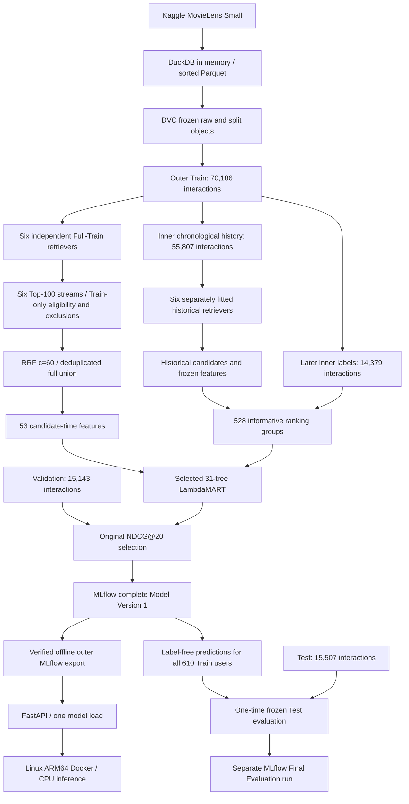

# System architecture and reproducibility boundaries

This repository implements one local MovieLens Small lifecycle, with independent data, training, evaluation and serving stages. Python sources are authoritative; the Small EDA notebook explains the data. The older MovieLens 32M/Colab work remains reference material in [the archive](../archive/legacy_movielens32m/README.md).

## Data lineage

Kaggle identifier `grouplens/movielens-latest-small` is the only acquisition source. Frozen raw provenance records CSV/ZIP hashes, schema and source. Only `ratings.csv` and `movies.csv` enter modeling; titles are descriptive and genre metadata supplies content signals. Tags, links, external metadata and pretrained embeddings are unused.

DuckDB parses explicit schemas, normalizes UTC submission times, keeps timestamp ties whole and writes sorted compressed Parquet. The primary split is `small_v1`, per-user chronological 70/15/15. DVC object `455595aeb5f24864381e436f11093797.dir` and manifest SHA256 `905f1370e919f06da3be728f95010d706b078c05f5c5e455c28da398ee41e799` identify it. The separate global sensitivity split is not a source for these models or pooled metrics.

Git versions code, parameters, lockfiles and DVC pointers. The external local DVC remote stores raw/processed objects; it does not contain MLflow's writable SQLite database or supply a model registry. See [data recovery](data_pipeline.md) and [the protocol](evaluation_protocol.md).

## Model and ranking lineage

The six independently loadable channels are Popularity, Genre CBF, sparse ItemCF, Implicit ALS, LightGCN and Hybrid Two-Tower. Each uses the entire permitted historical context, with objective-specific observed-positive/low/unknown conventions. Eligible items have a Train interaction; every item rated by the query user in Train is excluded. Top-100 is an upper bound. Source scores are uncalibrated, retained separately and ordered deterministically with movie-ID tie breaking.

RRF sums reciprocal source ranks with constant 60. It deduplicates the full union while retaining membership, raw scores, original ranks and fallback flags. The ranker scores every union candidate with the same 53-feature schema: source evidence, RRF, history/popularity, genre signals and pool statistics. Absent source scores remain NaN and absent ranks 101.

Historical ranker examples come from **six separate models trained on the inner 55,807-row history**, followed by candidates/features, followed by later labels. The full-Train models are never used to generate supposedly out-of-sample training examples from their own interactions. Of 571 potentially eligible historical users, 528 have retrieved positives and contrast; the effective training table has 57,936 rows. Sampled unknowns carry a weak zero label, distinct from observed low ratings. Selection used external Validation NDCG@20, choosing 31 trees from 51 evaluated rounds. No final Test gradients or selection occurred.

Historical/full-Train snapshots differ in history lengths, catalog and score distributions. Phase 4 recorded missingness, feature distributions and sampling effects; no fitted normalization conceals this mismatch. See [ranking methodology and diagnostics](phase4_fusion_and_ranking.md).

## Release and serving lineage

Immutable `models:/MovieLensHybridRecommender/1` contains the six selected Full-Train inference states, one shared Train context, mappings and seen histories, RRF settings, schema, native booster and source/runtime manifests. Semantic release ID is `e4b38328a35c992114eb3e6acda90803f0aa16c61a027686d9e86b06bf5e475d`. Historical models remain training lineage. Cached held-out candidates/labels are absent from the release.

The raw release directory differs from the **outer MLflow export containing `MLmodel`** used by serving. Export inventories and registry identity are checked before loading. FastAPI calls this pyfunc once per request after one startup load; it implements no alternate model. Known users generate the complete six-channel pipeline. Unknown IDs explicitly receive Train popularity. The service never trains at startup.

Docker mounts only the verified export read-only, runs as a non-root user with bounded resources and publishes to localhost. Phase 6 actually verified exact native/Linux inference parity across 611 inputs and 12,220 recommendation rows, including offline restarts. These are serving correctness checks, distinct from Test quality. [Deployment instructions and measurements](phase6_fastapi_docker.md) remain the historical authority.

## Final evaluation lineage

Phase 7 froze Version 1, the original selection, evaluator source hashes, metrics and protocol. A process audit hook blocked Test, mixed label tables and raw ratings during Gates A/B. Gate A regenerated and exactly reproduced the existing Validation sources, union, rankings and metrics. Gate B generated all six streams for **all 610 Train users**, verified pyfunc Top-20 parity, then sealed checksummed source/feature/union/ranking artifacts. Candidate generation did not select users using future labels.

Only then did Gate C open Test, verify its payload hash/counts/boundaries, and select the frozen primary label-side population: 583 users and 6,725 eligible positives. Three methods rank the same fixed union. ALS preserves its original source ranks before a deterministic tail; RRF and LambdaMART score the identical deduplicated pool. Zero-hit queries remain. An independent all-observed diagnostic retains catalog-impossible targets. Paired bootstrap resamples users with replacement, seed 42, 2,000 replicates.

The new final-evaluation run references Version 1 without changing its payload, aliases, historical metrics or original `test_evaluated=false` tag. That tag records the original candidate's history; the separate evaluation record carries the later result. See [final assessment](phase7_final_evaluation.md) and [aggregate measurements](phase7_final_metrics.json). The evaluator is a separate `recsys_evaluation` package; all original model and serving source hashes remain unchanged.

## Reproducibility and production limits

- Phase 2 verified byte reproduction and cold DVC recovery on this Mac. Phase 3 actually retrained all six models in an isolated locked Mac environment with identical candidate bytes. These do not promise arbitrary-platform retraining bit identity.
- The DVC remote and MLflow SQLite/artifact store are local. GitHub contains neither objects nor model weights. A fresh clone needs the original stores/export or a separately reviewed reproduction; there is no independently verified one-command fresh-clone workflow.
- Frozen DVC stages depend on the whole historical pyproject/lock, and the writer embeds that lock in data identity. Later dependencies cause known drift. Do not force-reproduce v1 or rewrite its provenance. A dedicated data-environment contract requires a future versioned migration.
- Model bundles contain Train histories. Keep exports, per-query metrics and label outputs local/private. No public model/image publication or automatic registry promotion occurred.
- Inference is CPU-only. Exact historical Torch metadata pins require a CUDA-linked Linux wheel even though CUDA is unavailable; the verified image is 8.54 GB. A future smaller CPU contract requires an explicit new release, not editing Version 1.
- Optional direct Docker Registry startup is blocked by MLflow host-header HTTP 403. Offline export mode passed; server security was not weakened.
- Primary chronology is per user; cross-user future-information exposure is accepted. It is not a globally leakage-free prospective benchmark. Validation-based selection, small cohorts, weak unknown labels and snapshot distribution shift limit generalization. Sparse-user Recall@20 regresses relative to RRF on both Validation and Test.
- Timestamps represent rating submissions. Exposure logs, verified consumption, online CTR and causal satisfaction are unavailable. Local parity, small loopback timings and unit tests do not establish public production readiness.
